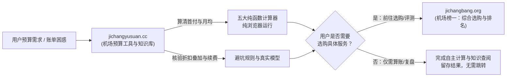

# 站群网络分工与主站转介协议 (NETWORK_ROLE.md)

> **生效日期**：2026-10-26  
> **本站角色**：预算工具与费用精算卫星站（jichangyusuan.cc）  
> **唯一主站**：机场榜一选购主站（jichangbang.org）

---

## 1. 站群定位与业务边界

### 1.1 分站职责（jichangyusuan.cc）
- 帮助用户建立清晰的支出模型：算清首次实付、月付 vs 年付现金流、倍率换算后实际每 GB 成本、满减打折叠加次序、到期续费与换站迁移成本。
- 提供客观、中立、不诱导消费的纯数学预算工具与透明知识库。
- 保证用户在不跳转主站的情况下，即可独立完成全套算账与避坑核验任务。

### 1.2 主站职责（jichangbang.org）
- 承接具备明确预算与选购意向的用户的综合选购。
- 维护实测机场综合排行榜、多地区线路实测数据、流媒体与专线解锁评测、具体服务商套餐购买入口。

---

## 2. 主站转介与链接规范

### 2.1 统一站点常量（集中配置在 `lib/config/site.ts`）
- `satelliteOrigin`: `https://jichangyusuan.cc`
- `satelliteName`: `机场预算`
- `mainOrigin`: `https://jichangbang.org`
- `mainName`: `机场榜一`

### 2.2 严格映射的目标路由
全站转介仅允许落到以下已验证的主站承接路径，严禁随意猜测未经验证的拼音路径：
1. **预算、月付、年付、流量、优惠核算结果**：`https://jichangbang.org/pricing/`
2. **两家服务横向对比或迁移取舍**：`https://jichangbang.org/compare/`
3. **综合选购推荐榜单**：`https://jichangbang.org/recommend/`
4. **品牌事实档案与评测详情**：`https://jichangbang.org/reviews/`

### 2.3 UTM 参数构造标准
所有从本站转往主站的外部链接必须由 `lib/links/handoff.ts` 纯函数通过 `URLSearchParams` 安全生成：
- `utm_source`: `jichangyusuan.cc`
- `utm_medium`: `referral`
- `utm_campaign`: 具体任务标识（如 `budget_selection`, `monthly_compare`, `annual_analysis`, `discount_audit`, `traffic_planning`）
- `utm_content`: `[页面ID或路由]_[位置标识]`（例如 `budget_calculator_result`, `plan_table_footer`）

### 2.4 安全与隐私底线
- **严禁泄漏私密数据**：UTM 参数中绝不携带用户输入的具体预算数值、账号、Token、密码或订阅链接。
- **免责与透明声明**：所有转介卡片（`MainSiteCTA`）均需清晰标示“前往主站机场榜一”，绝不伪装成本站自有结账页或官方客户端下载。
- **平稳跳转**：使用标准 `<a href="..." target="_blank" rel="noopener noreferrer">`，即使客户端未启用 JavaScript 或分析脚本被拦截，也能正常直接跳转。
- **自指规范**：全站 `<link rel="canonical">` 均自指本站相应干净 URL，严禁全站 canonical 归集到主站。
