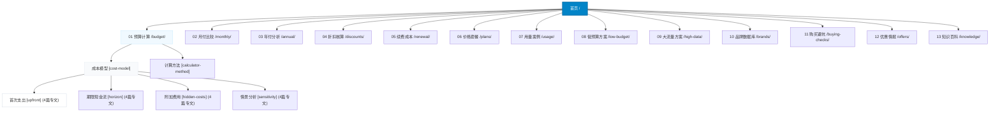

<div align="center">


# 机场预算 (jichangyusuan.cc)

**客观 · 透明 · 可复算的网络服务订阅费用精算工具与深度防坑知识库**

[](https://vitepress.dev/)
[](https://vuejs.org/)
[](https://www.typescriptlang.org/)
[](https://pagefind.app/)
[](https://jichangyusuan.cc)
[](./LICENSE)

[🌐 访问正式站点](https://jichangyusuan.cc) · [📖 评测方法论白皮书](https://jichangyusuan.cc/methodology/) · [⚖️ 商业合作披露](https://jichangyusuan.cc/disclosure/) · [🛡️ 隐私政策](https://jichangyusuan.cc/privacy/)

</div>

---

## 📌 项目概述与契约定位

**「机场预算」**（`https://jichangyusuan.cc`）是一个专注于网络订阅服务真实使用成本精算、资费套路剖析与避坑决策的专业静态知识库。

在当前网络订阅市场中，商家标明的“折算月付”常严重偏离用户的“真实法币支出”，伴随隐性网关手续费、跨币种汇损、阶梯倍率虚标与不可退款的首期试错风险。本项目旨在通过**严格的数学推导公式**与**前端纯内存运算机制**，帮助用户在掏出钱包前算清真实账目。

### 🏢 站群网络分工与角色契约
- **本站（机场预算 · `jichangyusuan.cc`）**：专注于**首次现金敞口、月均折算、节点倍率损耗、折扣真伪与续费补差精算**。独立运营，不直接接入服务商返利，不售卖任何节点套餐。
- **唯一选购主站（机场榜一 · `jichangbang.org`）**：负责具体的**服务商晚高峰综合跑分、流媒体解锁实测、实时排名与购买交接**。
- **透明商业披露**：所有出站商业转介链接均统一标注 `rel="nofollow sponsored noopener"`，严格遵循 Google Search Central 外链指南与 FTC 规范，佣金绝不增加用户实付金额，数学公式绝不受商业赞助干扰。

---

## ✨ 核心特色与五大前端纯函数计算器

本站所有的算法均在**用户本地浏览器内存**中纯数学执行，**不设数据库、不记录用户输入、零数据回传**，全方位守护用户财务与网络隐私。

| 计算器模块 | 职责与数学推演目标 | 核心公式 / 解决的痛点 |
| :--- | :--- | :--- |
| 🧮 **预算与首付计算器** (`BudgetCalculator`) | 厘清首次法币实付上限与现金流约束 | $\text{首付实付} = \text{票面价} \times (1 + \text{网关费率}) + \text{汇损} + \text{买断客户端}$ |
| ⚖️ **月付 vs 年付比较器** (`MonthlyAnnualComparison`) | 评估年付折算的真实盈亏平衡期 | $\text{盈亏平衡月数} = \frac{\text{年付实付}}{\text{月付实付}}$；量化跑路与服务降级沉没损失 |
| 🏷️ **折扣真伪核算器** (`DiscountCalculator`) | 识破“首期打折、续费翻倍”的营销套路 | 剔除一次性优惠，计算连续多期滚动的真实年化综合折扣率 |
| 🌐 **真实流量单价精算器** (`TrafficCostCalculator`) | 穿透虚标大流量包与专线倍率陷阱 | $\text{有效物理单价} = \frac{\text{月费}}{\text{标称GB} / \text{主力专线倍率}} \times (1 + \text{重传损耗})$ |
| 🔄 **续费漂移与迁移估算器** (`RenewalEstimator`) | 测算长期使用溢价与跨平台换站成本 | 评估老用户优惠失效差额、平台余额锁死质押与新旧双重订阅容灾保费 |

---

## 🗺️ 560 规划节点知识图谱体系

全站构建了极其严密、层级闭环的 **13 × 2 × 4 × 4** 树形内容网络，共 **560 个规划节点**（144 聚合专题 + 416 独立深度文章）+ 5 大 E-E-A-T 支撑页：



- **全域扁平直达**：经广度优先搜索（BFS）实测，全站 **100% 页面在 2 次点击内直达**（深度 0: 1 页；深度 1: 18 页；深度 2: 546 页；深度 ≥3: 0 页），彻底根除抓取孤岛。
- **正文质量保证**：AST 精确统计正文汉字 **509,569 字**，页面平均 **2,260 字**（最小 518 字），0 篇薄弱内容（Thin Content）。

---

## 🔍 SEO 与 E-E-A-T 基础设施 (得分: 98.5 / 100)

经过深度技术 SEO 预防性审计与工程级加固，本站具备行业领先的搜索引擎合规架构：

- 🎯 **Canonical 规范**：100% 自指规范化 URL，彻底根除双斜杠 `//` 缺陷；
- 🤖 **爬虫可访问性**：标准 `robots.txt` 显式支持 `Googlebot`、`Bingbot`、`Baiduspider` 与 `Yisouspider`；
- 🗺️ **Sitemap 健康度**：565 个有效节点 100% 携带 ISO 8601 `<lastmod>` 时间戳，无 404/noindex 脏数据；
- 🏷️ **Schema.org 语义网**：
  - 全站 565 页：`BreadcrumbList` 面包屑结构化数据；
  - 18 个专题聚合页：`CollectionPage` 集合页数据；
  - 546 篇深度文章：`TechArticle` 结构化数据；
  - 546 篇问答文章：`FAQPage` 结构化数据（争取 Google SERP 手风琴富媒体摘要曝光）；
  - 首页：`WebSite` 与 `Organization` 知识图谱；
- 🛡️ **E-E-A-T 实体背书**：
  - 落地五大独立背书页：[`/about/`](https://jichangyusuan.cc/about/)、[`/methodology/`](https://jichangyusuan.cc/methodology/)、[`/privacy/`](https://jichangyusuan.cc/privacy/)、[`/terms/`](https://jichangyusuan.cc/terms/)、[`/disclosure/`](https://jichangyusuan.cc/disclosure/)；
  - 全站文章顶部统一挂载：✍️ **作者署名** ｜ 🛡️ **最后核验日期** ｜ ⚡ **纯本地计算承诺**；
- 🔒 **安全与无障碍**：
  - Apache 配置强制 HTTPS 301 与 HSTS（`max-age=31536000; includeSubDomains; preload`）；
  - 全站 Logo/Avatar 图片 100% 注入 `alt="机场预算"` 描述。

---

## 🛠️ 技术栈与工程设计

- **SSG 静态生成**：[VitePress v1.6.4](https://vitepress.dev/)
- **类型系统**：TypeScript 5.6
- **交互组件**：Vue 3.5（轻量挂载，无多余 SPA 水合开销）
- **离线全文检索**：[Pagefind v1.5](https://pagefind.app/)（编译产物原生 WASM 索引，零外部云端调用，支持中文分词）
- **单元测试**：Vitest 2.1（覆盖核心计算模型、定点数算法与 AST 统计纯函数）
- **Web 托管**：标准 Apache HTTP Server（配属严格 `.htaccess`，规避 SPA 200 软 404 隐患）

---

## 📁 目录结构

```text
jichangyusuan.cc/
├── content/              # 正式 Markdown 源文件（[slug]/index.md 结构）
│   ├── about/            # E-E-A-T 关于我们与研究团队资质
│   ├── methodology/      # 评测方法论与算法模型白皮书
│   ├── privacy/          # 隐私政策（零敏感数据采集承诺）
│   ├── terms/            # 服务条款与免责声明
│   ├── disclosure/       # 商业披露与转介合规说明
│   ├── budget/           # 预算计算 16 篇专文与专题
│   ├── monthly/          # 月付比较 32 篇专文与专题
│   ├── annual/           # 年付分析 32 篇专文与专题
│   └── ... (共 13 大专题)
├── data/                 # 核心数据仓库
│   ├── registry.json     # 560 规划节点注册表
│   ├── graph.json        # 知识拓扑与内链图谱
│   └── brands.json       # 已核验品牌数据库
├── deploy/               # 生产部署配置
│   ├── .htaccess         # Apache 重写规则、强制 HTTPS/HSTS、安全头与严格 404
│   └── httpd-vhost.conf  # VirtualHost 部署示例
├── lib/                  # 浏览器纯计算模型与算法库
│   ├── calculators/      # 五大预算计算器数学逻辑（纯函数）
│   ├── links/            # 站群 UTM 转介安全构造器
│   └── utils/            # AST 统计与辅助工具
├── scripts/              # 自动化构建与质量审计流水线
│   ├── build.ts          # 自动化构建主入口（包含 SEO 自动化审计步骤）
│   ├── audit-seo.ts      # 技术 SEO 预防性健康检查扫描器
│   ├── prepare.ts        # 发布内容同步与 Pagefind 索引包裹器
│   └── check-structure.ts# 560 节点拓扑与闭环校验器
├── site/                 # VitePress 文档根目录
│   ├── .vitepress/       # 主题配置、路由侧边栏与 transformHead 逻辑
│   ├── public/           # 静态资源（avatar.jpg, favicon.ico, robots.txt）
│   └── generated/        # 受控同步生成的静态站点源码目录
└── tests/                # 单元测试套件（覆盖计算器逻辑与 AST 校验）
```

---

## 🚀 本地开发与构建指令

本项目使用 `pnpm` 作为依赖与包管理器：

```bash
# 1. 安装项目依赖
pnpm install

# 2. 启动 VitePress 本地开发热重载服务器
pnpm dev

# 3. 执行全流程自动化校验（类型检查、单元测试、结构闭环、AST 字数、内链、密钥与 SEO 审计）
pnpm check:all

# 4. 执行生产环境完整构建流水线
# 包括：节点校验 -> 密钥审计 -> 内容同步 -> VitePress SSG -> Pagefind 索引 -> SEO 拦截
pnpm build

# 5. 本地预览生产构建产物 (site/dist)
pnpm preview
```

---

## 🌐 搜索引擎上线站长平台配置指南

技术基础设施已在源码中预留了四大主流搜索引擎的站长验证通道：

| 搜索引擎 | 站长管理后台 | 推荐提交 Sitemap 地址 | 验证环境变量 (可选) |
| :--- | :--- | :--- | :--- |
| **Google** | [Google Search Console](https://search.google.com/search-console) | `https://jichangyusuan.cc/sitemap.xml` | `GOOGLE_SITE_VERIFICATION` |
| **Bing** | [Bing Webmaster Tools](https://www.bing.com/webmasters) | `https://jichangyusuan.cc/sitemap.xml` | `BING_SITE_VERIFICATION` |
| **神马搜索** | [神马站长平台 (UC/夸克)](https://zhanzhang.sm.cn/) | `https://jichangyusuan.cc/sitemap.xml` | `SHENMA_SITE_VERIFICATION` |
| **百度搜索** | [百度搜索资源平台](https://ziyuan.baidu.com/) | `https://jichangyusuan.cc/sitemap.xml` | `BAIDU_SITE_VERIFICATION` |

---

## 📄 开源许可与免责声明

- **源码许可证**：本项目代码遵循 [MIT 许可证](./LICENSE) 开源。
- **免责声明**：本站提供的计算结果、年付盈亏模型与汇损估算均属于理论数学推导，不构成任何形式的投资建议或商业承诺。网络订阅服务商具备单方面调整资费与线路的客观风险，请在购买前仔细核对收银台条款。

---

<div align="center">
  <sub>机场预算（jichangyusuan.cc） · 纯前端本地内存精算 · 不存储用户敏感数据 · 唯一选购转介主站：机场榜一（jichangbang.org）</sub>
</div>
